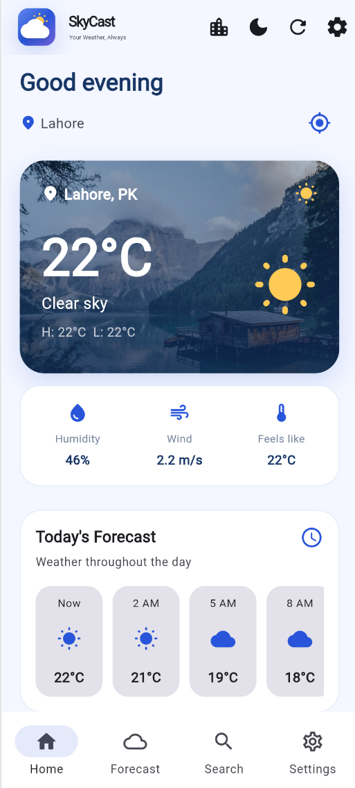
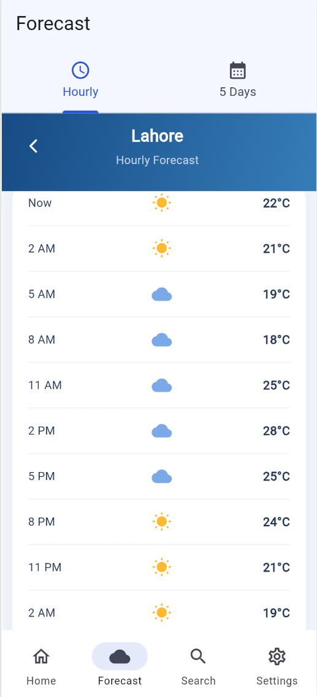
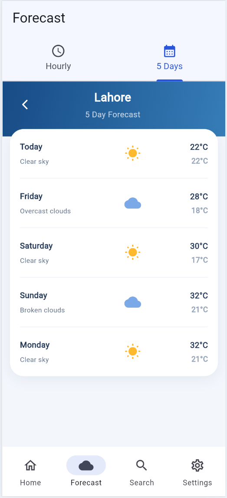
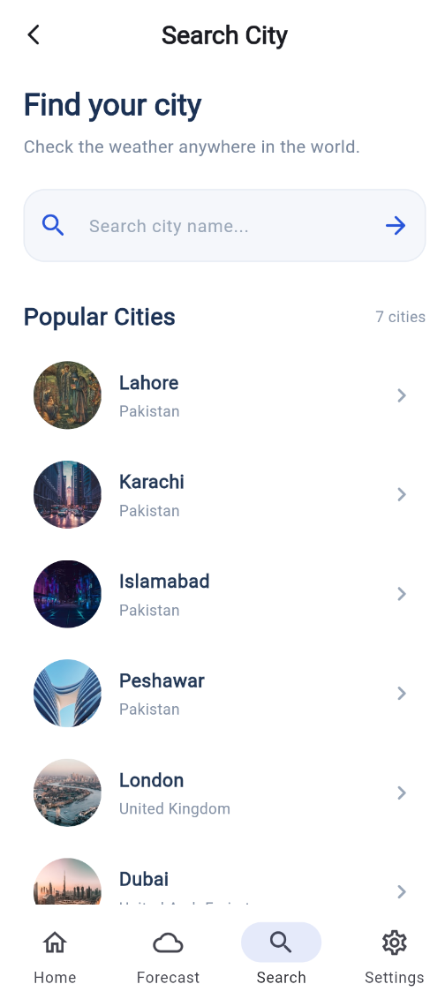
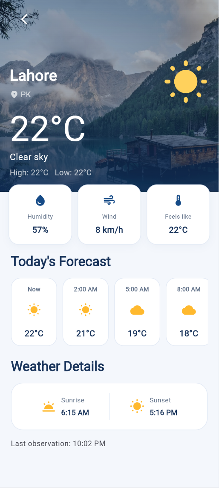
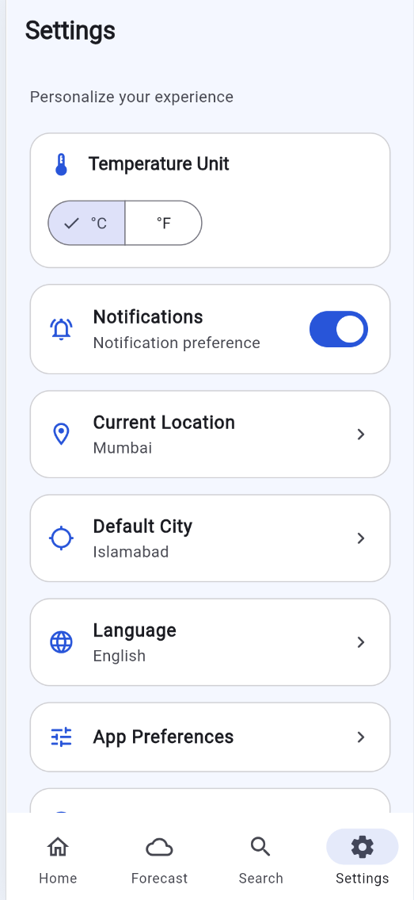

# 🌦️ SkyCast — Weather Forecast App

A modern weather application built with **Flutter** that integrates the **OpenWeather API to retrieve current weather** information and helps users explore weather conditions and forecasts through a clean, user-friendly interface. SkyCast supports **English and Urdu**, along with **Celsius and Fahrenheit** temperature preferences.

## ✨ Features

- **Live Weather Updates:** Retrieve current weather conditions using the OpenWeather API.
- 🌤️ **Weather Information** — View weather conditions and temperature information.
- ⏰ **Hourly Forecast** — Explore forecast information by hour.
- 📅 **Five-Day Forecast** — Check upcoming weather predictions.
- **Loading & Error Handling:** Provide fallback while data loads and when requests fail.
- 🔍 **City Search** — Search for a city to explore its weather.
- 🌍 **Popular Cities** — Quickly explore selected popular cities.
- 🌐 **Bilingual Interface** — Switch between English and Urdu.
- 🌡️ **Temperature Units** — Choose between Celsius (°C) and Fahrenheit (°F).
- ⚙️ **Settings & Preferences** — Customize supported app preferences.
- 🎨 **Modern UI** — A clean interface with a blue and purple visual theme.

## 🛠️ Tech Stack

- **Flutter** — Cross-platform app development
- **Dart** — Application programming language
- **OpenWeather API** — Weather data
- **Material Design** — User interface components

## 📱 Screenshots

- Home Screen

- Hourly Forecast

- Five-Day Forecast

- City Search

- Weather Details

- Settings


## 🚀 Getting Started

### Prerequisites

Make sure you have the following installed:

- Flutter SDK
- Dart SDK (included with Flutter)
- Android Studio or Visual Studio Code
- An OpenWeather API key

### Installation

**1. Clone the repository**

```bash
git clone YOUR_GITHUB_REPOSITORY_URL
```

**2. Navigate to the project directory**

```bash
cd Sky_Cast
```

**3. Install dependencies**

```bash
flutter pub get
```
### Note
Forecast screens may display sample data when live forecast data is unavailable.

**4. Configure your API settings**

Create your local `env.json` configuration file using the format expected by your project's existing code. Add your OpenWeather API key and any other required values.

**Important:** Do not upload `env.json` or expose your API key publicly. Ensure sensitive configuration files are included in `.gitignore`.

**5. Run the application**

For Chrome:

```bash
flutter run -d chrome --dart-define-from-file=env.json
```

For Android, connect your device or start an emulator, then run the command appropriate for your existing configuration.

## 📂 Project Structure

```text
Sky_Cast/
├── lib/
│   ├── core/
│   │   ├── app_preferences.dart
│   │   └── app_translations.dart
│    ├── models/
│   │   ├── current_weather.dart 
│   │   └── daily_forecast.dart
│   │   └── hourly_forecast.dart 
│   ├── screens/
│   │   ├── bottom_navigation.dart
│   │   ├── splash_screen.dart
│   │   ├── settings_screen.dart
│   │   ├── home_screen.dart
│   │   ├── weather_details_screen.dart
│   │   ├── search_screen.dart
│   │   ├── hourly_forecast_screen.dart
│   │   └── daily_forecast_screen.dart
│   ├── services/
│   │   ├── daily_forecast.dart
│   │   ├── demo_forecast.dart
│   │   ├── forecast_service.dart
│   │   ├── location_service.dart
│   │   ├── weather_service.dart
│   ├── widgets/
│   │   ├── skycast_logo.dart
│   └── main.dart
├── test/
├── android/
├── web/
├── pubspec.yaml
└── README.md
```


## 🎯 Project Goals

SkyCast was developed to practice Flutter application development, API integration, responsive UI design, localization, and user preferences while creating a useful weather experience.

## 🔮 Future Improvements

- More detailed weather insights
- Additional weather-related UI enhancements
- Improved forecast visualizations
- Further accessibility and usability improvements

## 👩‍💻 Author

**Sidra Tul Muntaha**

Flutter Developer | Mobile App Development Enthusiast

---

⭐ If you find this project interesting, consider giving the repository a star!

*Built with Flutter 💙*
